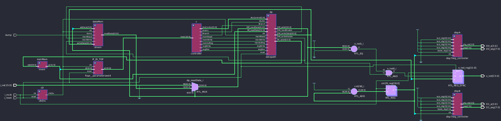
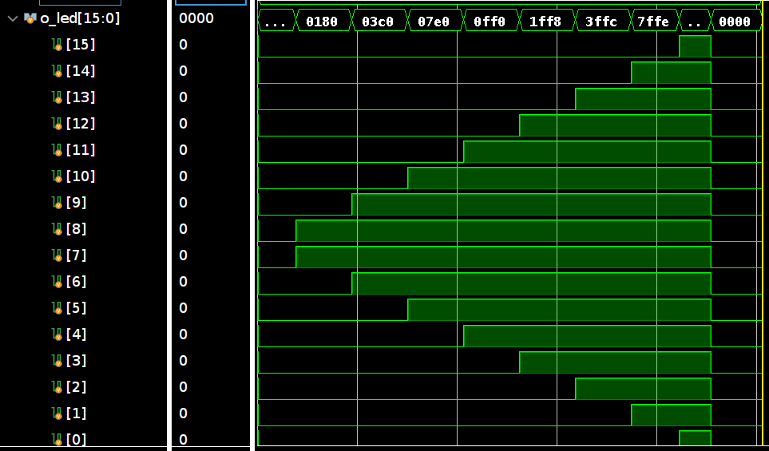

# ***INFORME LAB 1 ARQ DEL COMPUTADOR***
## Integrantes
- **Integrante 1: Lautaro Pinilla**
- **Integrante 2: Milena Juarez**

## Ejercicios resueltos:
- Ejercicio 1

## Cambios surgidos en base a las recomendaciones
### Tiempo de ejecucion de vivado
Aumentamos el tiempo de ejecucion a 50000ns para evitar errores en la generacion del mem.dump  
### regfile.sv
**Objetivo**: Implementar forwarding interno para resolver hazards.  
Se agregaron puertos para el Writeback:  
``` assembly
input logic we3_W,              //write enable desde Writeback
input logic [4:0] wa3_W,        //write address desde Writeback  
input logic [N-1:0] wd3_W,      //write data desde Writeback
```
Logica de lectura modificada para soportar forwarding:  
``` assembly
//--- Lectura asincrona con forwarding interno ---
//Verifico primero si es XZR, luego si hay forwarding desde Writeback, sino lectura normal
assign rd1 = (ra1 == 5'b11111) ? {N{1'b0}} :              //si es XZR => 0
             (we3_W && (ra1 == wa3_W)) ? wd3_W :          //si WB escribe este reg => forward
             REGS[ra1];                                   //si no => leer normal
    
assign rd2 = (ra2 == 5'b11111) ? {N{1'b0}} :              //si es XZR => 0
             (we3_W && (ra2 == wa3_W)) ? wd3_W :          //si WB escribe este reg => forward
             REGS[ra2];                                   //si no => leer normal
```
De esta forma cuando se lea un registro en Decode al mismo tiempo que dicho registro se escribe en Writeback retorna el valor actualizado.  
### decode.sv
**Objetivo**: Conectar las señales de forwarding desde Writeback al regfile.  
Se agregaron las conexiones nuevas del regfile:  
``` assembly
regfile registers(.clk(clk),
	              .we3(regWrite_D),
	              .we3_W(regWrite_D),              //mismo enable para forwarding
	              .ra1(instr_D[9:5]),
	              .ra2(ra2),
	              .wa3(wa3_D),
	              .wa3_W(wa3_D),              	   //mismo address para forwarding
	              .wd3(writeData3_D),
	              .wd3_W(writeData3_D),            //mismo data para forwarding
	              .rd1(readData1_D),
	              .rd2(readData2_D));
```
### fetch.sv
**Objetivo**: Actualizar nombres del adder debido a que el de la catedra usa otros nombres distintos al que teniamos:  
``` assembly
//ADDER: input -> [N-1:0] a, b; output -> [N-1:0] y
adder #(N) ADD (
    .a(PC_out),
    .b(64'h4),
    .y(adder_out)
);
```
### imem.sv
**Objetivo**: Soportar programas mas largos:  
``` assembly
//addr = 10 ya que 2^10 = 512
//addr sirve para indicar que palabra de esas 512 va a leer, es un indice nomas
input logic [8:0] addr,
output logic [N-1:0] q
);
    
//Uso unpacked arrays, ROM tiene 512 elementos(palabras en este caso) de 32bits c/u
//Inicializo cada palabra en 0
logic [N-1:0] ROM [0:511] = '{default: 'b0};
```
Esto es debido a que el codigo con NOPS es muy largo y 64 posiciones no es suficiente.  
### processor_arm.sv
**Objetivo**: Actualizar el tamaño del adder al nuevo:  
``` assembly
imem instrMem (.addr(IM_address[10:2]),
			   .q(q));
);
```
### top_tb.sv
**Objetivo**: Instanciar el dut y generar el dump correctamente.  
Cambianos la instanciacion del dut para evitar posibles errores:  
``` assembly
processor_arm dut (
    .i_sw(i_sw),
    .i_mclk(i_mclk),
    .i_reset(i_reset),
    .o_led(o_led),
    .D0_seg(D0_seg),
    .D1_seg(D1_seg),
    .D0_a(D0_a),
    .D1_a(D1_a),
    .dump(dump)
);
```
Nuestra secuencia de dump comienza en 0, da 10000ns para ejecutar el programa entero, activa el dump y da 100ns para generar el mem.dump  
``` assembly
initial
    begin
      dump = 0; i_mclk = 0; i_reset = 1; i_sw = 1;
      #20; i_reset = 0;
      #10000; dump = 1;
      #100;
      $stop;
	end 
```

## Cambios surgidos por LSL y LSR
### alu.sv
**Objetivo**: Implementar LSL y LSR:
```assembly
4'b1001: result = a << b[5:0]; // LSL
4'b1000: result = a >> b[5:0]; // LSR
```
### aludec.sv
**Objetivo**: Implementar LSL y LSR:
```assembly
else if((aluop == 2'b10)  & (funct == 11'b11010011011)) alucontrol = 4'b1001;	//LSR
else if((aluop == 2'b10)  & (funct == 11'b11010011010)) alucontrol = 4'b1000;	//LSL 
```
### maindec.sv
**Objetivo**: Implementar LSL y LSR:
```assembly
11'b110_1001_1011,  // LSL
11'b110_1001_1010:  // LSR
begin
	Reg2Loc = 1'b0;
    ALUSrc = 1'b1;
    MemtoReg = 1'b0;
    RegWrite = 1'b1;
    MemRead = 1'b0;
    MemWrite = 1'b0;
    Branch = 1'b0;
    ALUOp = 2'b10; 
end
```
### signext.sv
**Objetivo**: Implementar LSL y LSR:
```assembly
//LSL - usar immr (bits 21:16)
11'b110_1001_1011: y = {{58{1'b0}}, (6'd64 - a[21:16])};
//LSR - usar imms (bits 15:10)  
11'b110_1001_1010: y = {{58{1'b0}}, a[15:10]};
```
### processor_arm.sv
**Objetivo**: Agregar chequeo por DM_writeEnable
```assembly
always_ff @(posedge i_mclk)
    if (i_reset)
        o_led <= 16'h0000;
    else if (DM_addr == 64'h8000 && DM_writeEnable)
        o_led <= DM_writeData[15:0];
```
## Diagrama del nuevo procesador

## Codigos
### Codigo assembly con NOPS para testear el procesador
**Objetivo**: Agregar NOPS para resolver los hazards.  
Los NOPS los agregamos de a 2. En total son 40 NOPS agregados.  
``` assembly
.text
	.org 0x0000

STUR X1, [X0, #0]      //guarda X1 en memoria base X0
STUR X2, [X0, #8]      //guarda X2 en memoria base X0
STUR X3, [X16, #0]     //guarda X3 en memoria base X16
ADD X3, X4, X5         //suma X4 y X5 en X3
ADD XZR, XZR, XZR      //NOP
ADD XZR, XZR, XZR      //NOP
STUR X3, [X0, #24]     //guarda X3 en memoria base X0
SUB X3, X4, X5         //resta X5 a X4 y guarda en X3
ADD XZR, XZR, XZR      //NOP
ADD XZR, XZR, XZR      //NOP
STUR X3, [X0, #32]     //guarda X3 en memoria base X0
SUB X4, XZR, X10       //carga el negado de X10 en X4
ADD XZR, XZR, XZR      //NOP
ADD XZR, XZR, XZR      //NOP
STUR X4, [X0, #40]     //guarda X4 en memoria base X
ADD X4, X3, X4         //suma X3 y X4 en X4
ADD XZR, XZR, XZR      //NOP
ADD XZR, XZR, XZR      //NOP
STUR X4, [X0, #48]     //guarda X4 en memoria base X0
SUB X5, X1, X3         //resta X3 a X1 y guarda en X5
ADD XZR, XZR, XZR      //NOP
ADD XZR, XZR, XZR      //NOP
STUR X5, [X0, #56]     //guarda X5 en memoria base X0
AND X5, X10, XZR       //pone en X5 el resultado de X10 AND 0
ADD XZR, XZR, XZR      //NOP
ADD XZR, XZR, XZR      //NOP
STUR X5, [X0, #64]     //guarda X5 en memoria base X0
AND X5, X10, X3        //pone en X5 el resultado de X10 AND X3
ADD XZR, XZR, XZR      //NOP
ADD XZR, XZR, XZR      //NOP
STUR X5, [X0, #72]     //guarda X5 en memoria base X0
AND X20, X20, X20      //mantiene X20 igual
ADD XZR, XZR, XZR      //NOP
ADD XZR, XZR, XZR      //NOP
STUR X20, [X0, #80]    //guarda X20 en memoria base X
ORR X6, X11, XZR       //copia X11 en X6
ADD XZR, XZR, XZR      //NOP
ADD XZR, XZR, XZR      //NOP
STUR X6, [X0, #88]     //guarda X6 en memoria base X0
ORR X6, X11, X3        //pone en X6 el resultado de X11 OR X
ADD XZR, XZR, XZR      //NOP
ADD XZR, XZR, XZR      //NOP
STUR X6, [X0, #96]     //guarda X6 en memoria base X0
LDUR X12, [X0, #0]     //carga en X12 desde memoria base X0
ADD XZR, XZR, XZR      //NOP
ADD XZR, XZR, XZR      //NOP
ADD X7, X12, XZR       //copia X12 en X7
ADD XZR, XZR, XZR      //NOP
ADD XZR, XZR, XZR      //NOP
STUR X7, [X0, #104]    //guarda X7 en memoria base X0
STUR X12, [X0, #112]   //guarda X12 en memoria base X0
ADD XZR, X13, X14      //suma X13 y X14 descartando el resultado
STUR XZR, [X0, #120]   //guarda 0 en memoria base X0
CBZ X0, L1             //salta a L1 si X0 es 0
ADD XZR, XZR, XZR      //NOP despues de CBZ
ADD XZR, XZR, XZR      //NOP despues de CBZ
STUR X21, [X0, #128]   //guarda X21 en memoria base X0
L1: STUR X21, [X0, #136] //guarda X21 en memoria base X0
ADD X2, XZR, X1        //copia X1 en X2
ADD XZR, XZR, XZR      //NOP
ADD XZR, XZR, XZR      //NOP
L2: SUB X2, X2, X1     //resta X1 a X2
ADD XZR, XZR, XZR      //NOP
ADD XZR, XZR, XZR      //NOP
ADD X24, XZR, X1       //copia X1 en X24
ADD XZR, XZR, XZR      //NOP
ADD XZR, XZR, XZR      //NOP
STUR X24, [X0, #144]   //guarda X24 en memoria base X0
ADD X0, X0, X8         //incrementa X0 con X8
ADD XZR, XZR, XZR      //NOP
ADD XZR, XZR, XZR	   //NOP
CBZ X2, L2			   //salta a L2 si X2 es 0
ADD XZR, XZR, XZR      //NOP despues de CBZ
ADD XZR, XZR, XZR      //NOP despues de CBZ
STUR X30, [X0, #144]   //guarda X30 en memoria base X0
ADD XZR, XZR, XZR      //NOP antes de modificar X30
ADD XZR, XZR, XZR      //NOP antes de modificar X30
ADD X30, X30, X30      //duplica X30
ADD XZR, XZR, XZR      //NOP despues de modificar X30
ADD XZR, XZR, XZR      //NOP despues de modificar X30
SUB X21, XZR, X21	   //invierte el signo de X21
ADD XZR, XZR, XZR      //NOP despues de modificar X21
ADD XZR, XZR, XZR      //NOP despues de modificar X21
ADD X30, X30, X20      //suma X30 con X20
ADD XZR, XZR, XZR      //NOP antes de usar X30 en LDUR
ADD XZR, XZR, XZR      //NOP antes de usar X30 en LDUR
LDUR X25, [X30, #-8]   //carga en X25 desde X30-8
ADD XZR, XZR, XZR      //NOP despues de LDUR
ADD XZR, XZR, XZR      //NOP despues de LDUR
ADD X30, X30, X30	   //duplica X30
ADD XZR, XZR, XZR      //NOP
ADD XZR, XZR, XZR      //NOP
ADD X30, X30, X16      //suma X30 con X16
ADD XZR, XZR, XZR      //NOP antes de usar X30 y X25
ADD XZR, XZR, XZR      //NOP antes de usar X30 y X25
STUR X25, [X30, #-8]   //guarda X25 en X30-8
finloop: CBZ XZR, finloop
```

### Codigo usado para las luces
El programa implementa un efecto de "onda expansiva" comienza encendiendo los leds del centro hasta llegar los de los extremos.  
Primero se comienza con los leds 7-8 que son los del centro, luego se va haciendo una la onda:
- LEDS 7-8
- LEDS 6-9
- LEDS 5-10
- LEDS 4-11
- LEDS 3-12
- LEDS 2-13
- LEDS 1-14
- LEDS 0-15
Al finalizar se apagan todos los leds.  
Se hace uso principalmente de LSL y ORR.  
El delay entre niveles está implementado mediante instrucciones NOP.  

El codigo es el siguiente:
```assembly
.text
.org 0x0000

inicio:
// ===== INICIALIZACION =====
LSL X20, X1, X15      //X20 = 0x8000
ADD XZR, XZR, XZR
ADD XZR, XZR, XZR
ADD XZR, XZR, XZR

// ===== EXPANSION 1: LEDS 7-8 (centro) =====
LSL X21, X1, #7       //LED 7
ADD XZR, XZR, XZR
ADD XZR, XZR, XZR
ADD XZR, XZR, XZR
LSL X22, X1, #8       //LED 8
ADD XZR, XZR, XZR
ADD XZR, XZR, XZR
ADD XZR, XZR, XZR
ORR X21, X21, X22
ADD XZR, XZR, XZR
ADD XZR, XZR, XZR
ADD XZR, XZR, XZR

STUR X21, [X20, #0]
ADD XZR, XZR, XZR
ADD XZR, XZR, XZR
ADD XZR, XZR, XZR
//DELAY
ADD XZR, XZR, XZR
ADD XZR, XZR, XZR
ADD XZR, XZR, XZR
ADD XZR, XZR, XZR
ADD XZR, XZR, XZR
ADD XZR, XZR, XZR
ADD XZR, XZR, XZR
ADD XZR, XZR, XZR

// ===== EXPANSION 2: LEDS 6-9 =====
LSL X22, X1, #6       //LED 6
ADD XZR, XZR, XZR
ADD XZR, XZR, XZR
ADD XZR, XZR, XZR
ORR X21, X21, X22
ADD XZR, XZR, XZR
ADD XZR, XZR, XZR
ADD XZR, XZR, XZR
LSL X22, X1, #9       //LED 9
ADD XZR, XZR, XZR
ADD XZR, XZR, XZR
ADD XZR, XZR, XZR
ORR X21, X21, X22
ADD XZR, XZR, XZR
ADD XZR, XZR, XZR
ADD XZR, XZR, XZR

STUR X21, [X20, #0]
ADD XZR, XZR, XZR
ADD XZR, XZR, XZR
ADD XZR, XZR, XZR
//DELAY
ADD XZR, XZR, XZR
ADD XZR, XZR, XZR
ADD XZR, XZR, XZR
ADD XZR, XZR, XZR
ADD XZR, XZR, XZR
ADD XZR, XZR, XZR
ADD XZR, XZR, XZR
ADD XZR, XZR, XZR

// ===== EXPANSION 3: LEDS 5-10 =====
LSL X22, X1, #5       //LED 5
ADD XZR, XZR, XZR
ADD XZR, XZR, XZR
ADD XZR, XZR, XZR
ORR X21, X21, X22
ADD XZR, XZR, XZR
ADD XZR, XZR, XZR
ADD XZR, XZR, XZR
LSL X22, X1, #10      //LED 10
ADD XZR, XZR, XZR
ADD XZR, XZR, XZR
ADD XZR, XZR, XZR
ORR X21, X21, X22
ADD XZR, XZR, XZR
ADD XZR, XZR, XZR
ADD XZR, XZR, XZR

STUR X21, [X20, #0]
ADD XZR, XZR, XZR
ADD XZR, XZR, XZR
ADD XZR, XZR, XZR
//DELAY
ADD XZR, XZR, XZR
ADD XZR, XZR, XZR
ADD XZR, XZR, XZR
ADD XZR, XZR, XZR
ADD XZR, XZR, XZR
ADD XZR, XZR, XZR
ADD XZR, XZR, XZR
ADD XZR, XZR, XZR

// ===== EXPANSION 4: LEDS 4-11 =====
LSL X22, X1, #4       //LED 4
ADD XZR, XZR, XZR
ADD XZR, XZR, XZR
ADD XZR, XZR, XZR
ORR X21, X21, X22
ADD XZR, XZR, XZR
ADD XZR, XZR, XZR
ADD XZR, XZR, XZR
LSL X22, X1, #11       //LED 11
ADD XZR, XZR, XZR
ADD XZR, XZR, XZR
ADD XZR, XZR, XZR
ORR X21, X21, X22
ADD XZR, XZR, XZR
ADD XZR, XZR, XZR
ADD XZR, XZR, XZR

STUR X21, [X20, #0]
ADD XZR, XZR, XZR
ADD XZR, XZR, XZR
ADD XZR, XZR, XZR
//DELAY
ADD XZR, XZR, XZR
ADD XZR, XZR, XZR
ADD XZR, XZR, XZR
ADD XZR, XZR, XZR
ADD XZR, XZR, XZR
ADD XZR, XZR, XZR
ADD XZR, XZR, XZR
ADD XZR, XZR, XZR

// ===== EXPANSION 5: LEDS 3-12 =====
LSL X22, X1, #3       //LED 3
ADD XZR, XZR, XZR
ADD XZR, XZR, XZR
ADD XZR, XZR, XZR
ORR X21, X21, X22
ADD XZR, XZR, XZR
ADD XZR, XZR, XZR
ADD XZR, XZR, XZR
LSL X22, X1, #12       //LED 12
ADD XZR, XZR, XZR
ADD XZR, XZR, XZR
ADD XZR, XZR, XZR
ORR X21, X21, X22
ADD XZR, XZR, XZR
ADD XZR, XZR, XZR
ADD XZR, XZR, XZR

STUR X21, [X20, #0]
ADD XZR, XZR, XZR
ADD XZR, XZR, XZR
ADD XZR, XZR, XZR
//DELAY
ADD XZR, XZR, XZR
ADD XZR, XZR, XZR
ADD XZR, XZR, XZR
ADD XZR, XZR, XZR
ADD XZR, XZR, XZR
ADD XZR, XZR, XZR
ADD XZR, XZR, XZR
ADD XZR, XZR, XZR

// ===== EXPANSION 6: LEDS 2-13 =====
LSL X22, X1, #2       //LED 2
ADD XZR, XZR, XZR
ADD XZR, XZR, XZR
ADD XZR, XZR, XZR
ORR X21, X21, X22
ADD XZR, XZR, XZR
ADD XZR, XZR, XZR
ADD XZR, XZR, XZR
LSL X22, X1, #13       //LED 13
ADD XZR, XZR, XZR
ADD XZR, XZR, XZR
ADD XZR, XZR, XZR
ORR X21, X21, X22
ADD XZR, XZR, XZR
ADD XZR, XZR, XZR
ADD XZR, XZR, XZR

STUR X21, [X20, #0]
ADD XZR, XZR, XZR
ADD XZR, XZR, XZR
ADD XZR, XZR, XZR
//DELAY
ADD XZR, XZR, XZR
ADD XZR, XZR, XZR
ADD XZR, XZR, XZR
ADD XZR, XZR, XZR
ADD XZR, XZR, XZR
ADD XZR, XZR, XZR
ADD XZR, XZR, XZR
ADD XZR, XZR, XZR

// ===== EXPANSION 7: LEDS 1-14 =====
LSL X22, X1, #1       //LED 1
ADD XZR, XZR, XZR
ADD XZR, XZR, XZR
ADD XZR, XZR, XZR
ORR X21, X21, X22
ADD XZR, XZR, XZR
ADD XZR, XZR, XZR
ADD XZR, XZR, XZR
LSL X22, X1, #14      //LED 14
ADD XZR, XZR, XZR
ADD XZR, XZR, XZR
ADD XZR, XZR, XZR
ORR X21, X21, X22
ADD XZR, XZR, XZR
ADD XZR, XZR, XZR
ADD XZR, XZR, XZR

STUR X21, [X20, #0]
ADD XZR, XZR, XZR
ADD XZR, XZR, XZR
ADD XZR, XZR, XZR
//DELAY
ADD XZR, XZR, XZR
ADD XZR, XZR, XZR
ADD XZR, XZR, XZR
ADD XZR, XZR, XZR
ADD XZR, XZR, XZR
ADD XZR, XZR, XZR
ADD XZR, XZR, XZR
ADD XZR, XZR, XZR

// ===== EXPANSION 8: LEDS 0-15 =====
ORR X21, X21, X1      //LED 0
ADD XZR, XZR, XZR
ADD XZR, XZR, XZR
ADD XZR, XZR, XZR
LSL X22, X1, #15      //LED 15
ADD XZR, XZR, XZR
ADD XZR, XZR, XZR
ADD XZR, XZR, XZR
ORR X21, X21, X22
ADD XZR, XZR, XZR
ADD XZR, XZR, XZR
ADD XZR, XZR, XZR

STUR X21, [X20, #0]
ADD XZR, XZR, XZR
ADD XZR, XZR, XZR
ADD XZR, XZR, XZR
//DELAY
ADD XZR, XZR, XZR
ADD XZR, XZR, XZR
ADD XZR, XZR, XZR
ADD XZR, XZR, XZR
ADD XZR, XZR, XZR
ADD XZR, XZR, XZR
ADD XZR, XZR, XZR
ADD XZR, XZR, XZR
ADD XZR, XZR, XZR
ADD XZR, XZR, XZR
ADD XZR, XZR, XZR
ADD XZR, XZR, XZR

// ===== APAGAR TODO =====
STUR XZR, [X20, #0]
ADD XZR, XZR, XZR
ADD XZR, XZR, XZR
ADD XZR, XZR, XZR
//DELAY
ADD XZR, XZR, XZR
ADD XZR, XZR, XZR
ADD XZR, XZR, XZR
ADD XZR, XZR, XZR
ADD XZR, XZR, XZR
ADD XZR, XZR, XZR
ADD XZR, XZR, XZR
ADD XZR, XZR, XZR

// ===== REPETIR =====
B inicio
```
